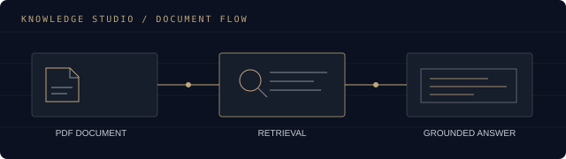
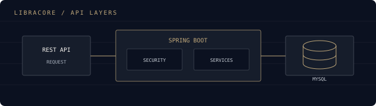
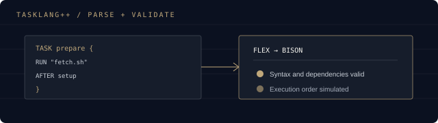
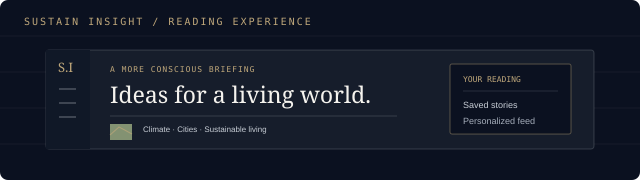

 

 

## About Me

Hi, I’m Sachith — a third-year Computer Science undergraduate at the Sri Lanka Institute of Information Technology (SLIIT). I’m exploring software engineering through backend systems, full-stack applications, and intelligent developer tools. My coursework and personal projects are helping me build practical experience while I strengthen the fundamentals behind reliable software.

## Technical Stack

Technologies I’ve used in projects and coursework; familiarity varies by project.

| Languages | Backend | Frontend |
|:---:|:---:|:---:|
|  Java · Python · C · C# · JavaScript · TypeScript · SQL |  Spring Boot · ASP.NET Core · REST APIs · Microservices · FastAPI (exposure) |  React · Next.js · HTML · CSS · Tailwind CSS |

| Databases & Caching | Cloud & Deployment | AI & Data |
|:---:|:---:|:---:|
|  MySQL · PostgreSQL · MongoDB · Supabase · Redis |  Azure · AWS · Vercel · Docker |  RAG · LangChain · ChromaDB · Agentic AI (exploring) · Data dashboards |

| Messaging & Streaming | Monitoring & Observability |
|:---:|:---:|
|  Apache Kafka · Event-driven services |  Prometheus · Grafana |

**Testing & Security**

Functional/UI automation · API testing · Load and performance testing · Security scanning

**Development Tools**

## Featured Engineering Projects

Selected individual, coursework, and collaborative work. The diagrams are original project illustrations, not screenshots.

<table>
  <tr>
    <td width="50%" valign="top">
      <h3>🧠 Knowledge Studio</h3>
      
      
Ask questions about lecture PDFs, inspect retrieved source passages, and create structured summaries with a persistent document index.

      
<code>Python</code> <code>Streamlit</code> <code>LangChain</code> <code>ChromaDB</code> <code>HuggingFace</code> <code>Groq</code>

      <a href="https://github.com/Sachith-Asmadala/Knowledge-Studio"><b>View repository ↗</b></a>
    </td>
    <td width="50%" valign="top">
      <h3>📚 LibraCore</h3>
      
      
A library and asset management API with catalog search, circulation workflows, JWT role security, and ISBN validation through a native C/JNI module.

      
<code>Java 21</code> <code>Spring Boot 3</code> <code>MySQL</code> <code>Flyway</code> <code>Docker</code>

      <a href="https://github.com/Sachith-Asmadala/LibraCore"><b>View repository ↗</b></a>
    </td>
  </tr>
  <tr>
    <td width="50%" valign="top">
      <h3>⚙️ TaskLang++</h3>
      
      
A coursework DSL for describing scheduled tasks and dependencies. Its parser validates workflows and simulates execution order; it does not run operating-system commands.

      
<code>C</code> <code>Flex</code> <code>Bison</code>

      <a href="https://github.com/Sachith-Asmadala/TaskLang"><b>View repository ↗</b></a>
    </td>
    <td width="50%" valign="top">
      <h3>🌱 Sustain Insight · Collaborative</h3>
      
      
A sustainability-focused news application combining article discovery, personalized feeds, and saved items across a React frontend and Spring Boot backend.

      
<code>Java</code> <code>Spring Boot</code> <code>PostgreSQL</code> <code>React</code> <code>TypeScript</code>

      <a href="https://sustain-insight-front-end.vercel.app"><b>Live demo ↗</b></a> · <a href="https://github.com/Sachith-Asmadala/Sustain-Insight---front-end"><b>Frontend ↗</b></a> · <a href="https://github.com/Sachith-Asmadala/Sustain-Insight---back-end"><b>Backend ↗</b></a>
    </td>
  </tr>
</table>

### More Work

<table>
  <tr>
    <td width="50%" valign="top">
      <h4>🧵 Textile &amp; Garment Management System</h4>
      
A web-based system that centralizes supplier, product, inventory, order, production, and delivery operations, with real-time tracking and secure role-based access.

      
<code>Java</code>

      <a href="https://github.com/Sachith-Asmadala/Web-Based-Textile-Garment-Management-System"><b>View repository ↗</b></a>
    </td>
    <td width="50%" valign="top">
      <h4>🔬 ResearchTrack Backend · Collaborative</h4>
      
ASP.NET Core microservices backend covering authentication, project management, GitHub and Jira integrations, meeting management, submission workflows, and API gateway routing.

      
<code>C#</code> <code>ASP.NET Core</code> <code>MySQL</code> <code>Microservices</code>

      <a href="https://github.com/Sachith-Asmadala/researchtrack-backend"><b>View repository ↗</b></a>
    </td>
  </tr>
  <tr>
    <td width="50%" valign="top">
      <h4>🤖 Agentic AI for Infrastructure &amp; Delivery</h4>
      
An LLM-powered autonomous agent for end-to-end DevOps workflows, handling infrastructure provisioning, continuous delivery, and system monitoring in place of static scripts.

      
<code>Python</code> <code>Agentic AI</code> <code>DevOps</code>

      <a href="https://github.com/Sachith-Asmadala/Autonomous-Infrastructure-Provisioning-and-Delivery-via-Agentic-AI"><b>View repository ↗</b></a>
    </td>
    <td width="50%" valign="top">
      <h4>📈 Retail Sales &amp; Business Performance Dashboard</h4>
      
A dashboard that helps a business understand its sales, customers, and product performance.

      
<code>Python</code>

      <a href="https://github.com/Sachith-Asmadala/Retail-Sales-Business-Performance-Dashboard"><b>View repository ↗</b></a>
    </td>
  </tr>
  <tr>
    <td width="50%" valign="top">
      <h4>📨 Fault-Tolerant Distributed Messaging · Collaborative</h4>
      
A group project on designing a fault-tolerant distributed messaging system.

      
<code>Distributed Systems</code>

      <a href="https://github.com/Sachith-Asmadala/Distributed_Systems_Group_30"><b>View repository ↗</b></a>
    </td>
    <td width="50%" valign="top">
      <h4>🎲 Yahtzee Retro Deluxe</h4>
      
A fully functional terminal Yahtzee game in C, showcasing modular design and game-state management.

      
<code>C</code>

      <a href="https://github.com/Sachith-Asmadala/Yahtzee-Retro-Deluxe"><b>View repository ↗</b></a>
    </td>
  </tr>
</table>

## GitHub Activity

  

## Engineering Interests

| | |
|:---|:---|
| **01** &nbsp; Backend engineering | **02** &nbsp; Full-stack systems |
| **03** &nbsp; AI-assisted applications | **04** &nbsp; DevOps, monitoring, and agentic automation |
| **05** &nbsp; Cloud (Azure, AWS) | **06** &nbsp; Software testing and security |
| **07** &nbsp; Microservices, messaging, and distributed systems | **08** &nbsp; Data and analytics dashboards |

## Currently Learning

Developing further in **data structures and algorithms**, **problem-solving**, **software testing**, and **backend engineering** through coursework and project practice.

## Let’s Connect

I’m open to Software Engineering Internship opportunities and conversations about building useful software.

Sachith Asmadala · Computer Science Undergraduate · SLIIT, Sri Lanka

