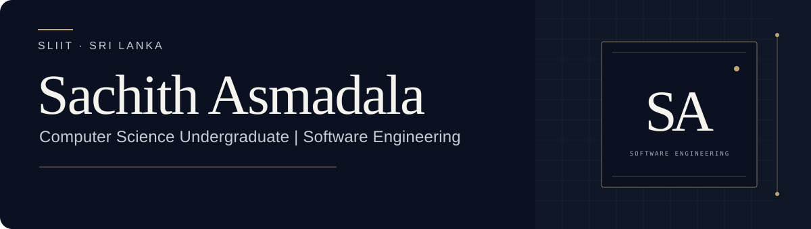

  

  <a href="https://github.com/Sachith-Asmadala">GitHub</a>&nbsp;&nbsp;·&nbsp;&nbsp;
  <a href="https://www.linkedin.com/in/sachith-asmadala-3b185a333/">LinkedIn</a>&nbsp;&nbsp;·&nbsp;&nbsp;
  <strong>Open to Software Engineering Internship opportunities</strong>

## About Me

Hi, I’m Sachith — a third-year Computer Science undergraduate at the Sri Lanka Institute of Information Technology (SLIIT). I’m exploring software engineering through backend systems, full-stack applications, and intelligent developer tools. My coursework and personal projects are helping me build practical experience while I strengthen the fundamentals behind reliable software.

## Technical Stack

Technologies I’ve used in projects and coursework; familiarity varies by project.

<table>
  <tr>
    <td width="50%" valign="top"><strong>Languages</strong> Java · Python · C · JavaScript · TypeScript · SQL</td>
    <td width="50%" valign="top"><strong>Backend</strong> Spring Boot · REST APIs · FastAPI (exposure)</td>
  </tr>
  <tr>
    <td width="50%" valign="top"><strong>Frontend</strong> React · HTML · CSS · Tailwind CSS</td>
    <td width="50%" valign="top"><strong>Databases</strong> PostgreSQL · MySQL</td>
  </tr>
  <tr>
    <td width="50%" valign="top"><strong>AI</strong> Retrieval-Augmented Generation (RAG) · LangChain · ChromaDB</td>
    <td width="50%" valign="top"><strong>Development Tools</strong> Git · GitHub · Docker · Maven · GitHub Actions · JUnit · pytest</td>
  </tr>
</table>

## Featured Engineering Projects

Selected individual, coursework, and collaborative work. The diagrams below are original project illustrations, not screenshots.

### Knowledge Studio

Ask questions about lecture PDFs, inspect retrieved source passages, and create structured summaries with a persistent document index.

**Python · Streamlit · LangChain · ChromaDB · HuggingFace · Groq** &nbsp;·&nbsp; [View repository ↗](https://github.com/Sachith-Asmadala/Knowledge-Studio)

### LibraCore

A library and asset management API with catalog search, circulation workflows, JWT role security, and ISBN validation through a native C/JNI module.

**Java 21 · Spring Boot 3 · MySQL · Flyway · Docker** &nbsp;·&nbsp; [View repository ↗](https://github.com/Sachith-Asmadala/LibraCore)

### TaskLang++

A coursework DSL for describing scheduled tasks and dependencies. Its parser validates workflows and simulates execution order; it does not run operating-system commands.

**C · Flex · Bison** &nbsp;·&nbsp; [View repository ↗](https://github.com/Sachith-Asmadala/TaskLang)

### Sustain Insight · Collaborative

A sustainability-focused news application combining article discovery, personalized feeds, and saved items across a React frontend and Spring Boot backend.

**Java · Spring Boot · PostgreSQL · React · TypeScript** &nbsp;·&nbsp; [Frontend ↗](https://github.com/Sachith-Asmadala/Sustain-Insight---front-end) · [Backend ↗](https://github.com/Sachith-Asmadala/Sustain-Insight---back-end)

## Engineering Interests

<table>
  <tr>
    <td width="50%"><strong>01</strong> &nbsp; Backend engineering</td>
    <td width="50%"><strong>02</strong> &nbsp; Full-stack systems</td>
  </tr>
  <tr>
    <td width="50%"><strong>03</strong> &nbsp; AI-assisted applications</td>
    <td width="50%"><strong>04</strong> &nbsp; DevOps and automation</td>
  </tr>
</table>

## Currently Learning

Developing further in **data structures and algorithms**, **problem-solving**, **software testing**, and **backend engineering** through coursework and project practice.

## Let’s Connect

I’m open to Software Engineering Internship opportunities and conversations about building useful software.

**[GitHub](https://github.com/Sachith-Asmadala)** &nbsp;·&nbsp; **[LinkedIn](https://www.linkedin.com/in/sachith-asmadala-3b185a333/)**

Sachith Asmadala · Computer Science Undergraduate · SLIIT, Sri Lanka

