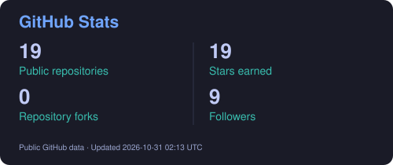
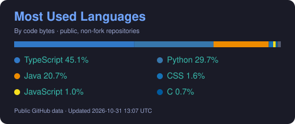

 

 

## About Me

Hi, I’m Sachith — a third-year Computer Science undergraduate at the Sri Lanka Institute of Information Technology (SLIIT). I’m building toward internships in **DevOps**, **software engineering**, and **AI/ML**, with hands-on work in backend systems, full-stack applications, cloud tooling, and AI-assisted products. My coursework and personal projects are helping me build practical experience while I strengthen the fundamentals behind reliable software.

## Focus Areas

| | DevOps | Software Engineering | AI / ML |
|:---|:---:|:---:|:---:|
| **Tools** | Docker · GitHub Actions · Azure · AWS · Prometheus · Grafana · Kafka | Java · Spring Boot · C# · ASP.NET Core · React · Next.js | Python · RAG · LangChain · ChromaDB · Agentic AI |
| **Projects** | [ResearchTrack](https://github.com/Sachith-Asmadala/researchtrack-web) · [Agentic DevOps Assistant](https://github.com/Sachith-Asmadala/Autonomous-Infrastructure-Provisioning-and-Delivery-via-Agentic-AI) · [LibraCore](https://github.com/Sachith-Asmadala/LibraCore) | [ResearchTrack](https://github.com/Sachith-Asmadala/researchtrack-web) · [LibraCore](https://github.com/Sachith-Asmadala/LibraCore) | [Agentic DevOps Assistant](https://github.com/Sachith-Asmadala/Autonomous-Infrastructure-Provisioning-and-Delivery-via-Agentic-AI) · [Knowledge Studio](https://github.com/Sachith-Asmadala/Knowledge-Studio) |

## Technical Stack

Technologies I’ve used in projects and coursework; familiarity varies by project.

| Languages | Backend & APIs | AI / ML |
|:---:|:---:|:---:|
|  Java · Python · C · C# · JavaScript · TypeScript · SQL |  Spring Boot · ASP.NET Core · REST APIs · Microservices · FastAPI (exposure) |  RAG · LangChain · ChromaDB · Agentic AI (exploring) · Data dashboards |

| DevOps & Cloud | Observability & Messaging | Databases & Caching |
|:---:|:---:|:---:|
|  Docker · GitHub Actions · CI/CD · Azure · AWS · Vercel |  Prometheus · Grafana · Apache Kafka |  MySQL · PostgreSQL · MongoDB · Supabase · Redis |

| Frontend | Development Tools |
|:---:|:---:|
|  React · Next.js · HTML · CSS · Tailwind CSS |  Git · GitHub · Maven · JUnit · pytest |

**Testing & Security**

Functional/UI automation · API testing · Load and performance testing · Security scanning

## Featured Engineering Projects

Four projects across DevOps, software engineering, AI/ML, and data analytics. Animated diagrams show each project's architecture and data flow.

<table>
  <tr>
    <td width="50%" valign="top">
      <h3>🔬 ResearchTrack</h3>
      Software Engineering · DevOps · Collaborative
      
      
A research project management platform connecting students and supervisors through shared dashboards, GitHub and Jira activity, meetings, and submission reviews. Built with six ASP.NET Core microservices, a React workspace, and containerized deployment infrastructure.

      
<code>React</code> <code>ASP.NET Core</code> <code>MySQL</code> <code>Docker</code> <code>Azure</code> <code>GitHub Actions</code>

      
<b>View repositories:</b> <a href="https://github.com/Sachith-Asmadala/researchtrack-web"><b>Frontend ↗</b></a> · <a href="https://github.com/Sachith-Asmadala/researchtrack-backend"><b>Backend ↗</b></a>

    </td>
    <td width="50%" valign="top">
      <h3>🤖 Agentic DevOps Assistant</h3>
      DevOps · AI / ML
      
      
An agent-based CI/CD assistant that turns repository scans and failed build logs into actionable improvements. Analyzes project readiness, generates GitHub Actions workflows, and classifies failures with TF-IDF and Logistic Regression. Proposed fixes pass through human review, pull requests, and an audit trail.

      
<code>Python</code> <code>FastAPI</code> <code>React</code> <code>scikit-learn</code> <code>Docker</code> <code>GitHub Actions</code>

      <a href="https://github.com/Sachith-Asmadala/Autonomous-Infrastructure-Provisioning-and-Delivery-via-Agentic-AI"><b>View repository ↗</b></a>
    </td>
  </tr>
  <tr>
    <td width="50%" valign="top">
      <h3>🧠 Knowledge Studio</h3>
      AI / ML · Retrieval-Augmented Generation
      
      
A document-grounded Q&amp;A application for lecture PDFs. Builds reusable vector indexes, supports MMR and similarity retrieval, and generates answers and structured summaries with inspectable source passages.

      
<code>Python</code> <code>Streamlit</code> <code>LangChain</code> <code>ChromaDB</code> <code>HuggingFace</code> <code>Groq</code>

      <a href="https://github.com/Sachith-Asmadala/Knowledge-Studio"><b>View repository ↗</b></a>
    </td>
    <td width="50%" valign="top">
      <h3>📊 Retail Sales Analytics</h3>
      Data Analytics · Business Intelligence
      
      
A Sri Lankan retail analytics project using 5,000 synthetic order lines to calculate sales, profit, product, and regional/channel insights in LKR. Includes reproducible Python analysis, prepared Power Query and DAX assets, and a star-schema design with three report page specifications. Power BI Desktop implementation and verification are pending.

      
<code>Python</code> <code>CSV</code> <code>Power Query</code> <code>DAX</code> <code>Power BI (planned)</code>

      <a href="https://github.com/Sachith-Asmadala/Retail-Sales-Business-Performance-Dashboard"><b>View repository ↗</b></a>
    </td>
  </tr>
</table>

## GitHub Activity

  

## Engineering Interests

| | |
|:---|:---|
| **01** &nbsp; DevOps and cloud automation | **02** &nbsp; Backend engineering |
| **03** &nbsp; AI/ML and agentic AI applications | **04** &nbsp; Full-stack systems |
| **05** &nbsp; Monitoring and observability | **06** &nbsp; Microservices, messaging, and distributed systems |
| **07** &nbsp; Software testing and security | **08** &nbsp; Data and analytics dashboards |

## Currently Learning

Developing further in **data structures and algorithms**, **problem-solving**, **software testing**, **backend engineering**, and **CI/CD and cloud deployment** through coursework and project practice.

## Let’s Connect

I’m open to DevOps, Software Engineering, and AI/ML internship opportunities, and to conversations about building useful software.

Sachith Asmadala · Computer Science Undergraduate · SLIIT, Sri Lanka

